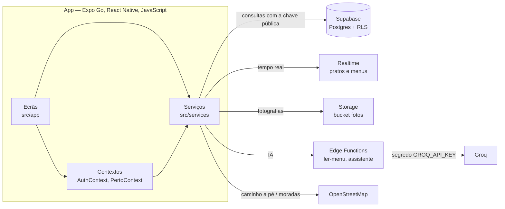

# Guia da defesa — Emmmenta

Defesa a **14–15 de janeiro de 2027**, com a app a funcionar ao vivo. Cada um defende o código dos seus requisitos; este guia junta as perguntas mais prováveis, a resposta curta e **o ficheiro onde está o código**, para se poder abrir e mostrar.

Como estudar: ler a secção do seu requisito, abrir cada ficheiro citado e conseguir explicar por palavras próprias. As perguntas gerais (secção 4) podem calhar a qualquer um.

---

## 1. A app num minuto

> A Emmmenta mostra **os pratos do dia dos restaurantes perto de ti, com preço, atualizados todos os dias**. O restaurante publica o menu em menos de um minuto (até por fotografia) e marca o que esgota; o cliente vê a lista e o mapa num raio de 2 km, filtra por preço, categoria e dieta, e chega a um menu em três toques. Tudo o que muda (esgotado, últimas doses, "cheio agora") aparece em tempo real.

Números para dizer: 7 requisitos funcionais feitos; mais de 450 testes automáticos (`npm test`); a pesquisa por distância responde em 0,35–1 s; tudo em planos gratuitos (Supabase, Groq, OpenStreetMap).

---

## 2. Arquitetura



- **Expo Router** (`src/app`): cada ficheiro é um ecrã. Em `src/app/_layout.js`, o `Stack.Protected` mostra um percurso por tipo de conta: sem sessão → login; cliente → Início / Mapa / Conta; restaurante → Painel / Perfil / Publicar. O primeiro ecrã de cada percurso está em `rotaInicial()` (`src/lib/navegacao.js`).
- **Camadas:** os ecrãs nunca falam com o Supabase; só as funções de `src/services/` (RNF09). Os contextos guardam o que vários ecrãs partilham (sessão, sítio onde se procura, filtros).
- **Segurança:** a app só tem a chave **pública** (`.env`). Quem pode ler e escrever é decidido na base de dados pelas regras **RLS**. Os segredos (chave da IA) estão no Supabase, nunca na app nem no GitHub.
- **Testes:** Jest, em `tests/`. Correm com `npm test`; o lint com `npx expo lint`.

---

## 3. Perguntas por pessoa

### Rodrigo — RF01 (contas) e RF02 (perfil do restaurante)

| Pergunta | Resposta curta | Onde |
|---|---|---|
| Como sabe a app se a conta é de cliente ou de restaurante? | No registo, o `signUp` envia `nome` e `tipo`; o trigger `ao_criar_utilizador` cria a linha em `perfis`. O `AuthContext` lê o perfil e o `_layout` escolhe o percurso. | `src/context/AuthContext.js`, `src/app/_layout.js` |
| Onde fica guardada a sessão? | No SecureStore (RNF01), dividida em partes de 1800 caracteres, porque o SecureStore só guarda ~2 KB por chave. | `src/lib/supabase.js` |
| Como validam os formulários? | `validarConta()` confirma os campos antes de falar com o servidor e devolve um erro por campo. Tem testes. | `src/lib/validarConta.js`, `tests/validarConta.test.js` |
| Porque pelo menos 8 caracteres? | É o que o Supabase recomenda; a proteção contra palavras-passe divulgadas só existe no plano pago. Ao entrar não se verifica, para as contas antigas continuarem a funcionar. | `TAMANHO_MINIMO_PALAVRA_PASSE` |
| Como funciona a recuperação da palavra-passe? | `resetPasswordForEmail` envia um código por email; `verifyOtp` (tipo `recovery`) confirma-o e `updateUser` grava a palavra-passe nova. A ref `aRedefinir` impede a app de mudar de ecrã a meio. | `src/context/AuthContext.js`, `src/app/login.js` |
| Como se põe a morada no mapa? | O texto da morada vai ao Nominatim (OpenStreetMap), que devolve as coordenadas; o pin pode ser arrastado. Não pede a localização do telemóvel. | `procurarMoradaNoMapa()` em `src/services/restaurantes.js`, `src/components/SeletorLocal.js` |
| Como é guardada a fotografia? | É comprimida até 500 KB (`comprimirFoto`, várias tentativas de tamanho e qualidade) e enviada para o bucket `fotos`, na pasta do utilizador; as regras do Storage só deixam escrever na própria pasta. | `enviarFotoRestaurante()` em `src/services/restaurantes.js` |
| Porque a câmara é dentro da app? | No Android, ao abrir a app da câmara, o sistema fechava a Emmmenta e a fotografia perdia-se. | `src/components/CameraNaApp.js` |
| Em que formato ficam o telefone e as horas? | Telefone `+351XXXXXXXXX` (pronto para `tel:`), horas `HH:MM:SS`. | `src/services/restaurantes.js` |

### José — RF03 (publicar o menu) e RF04 (esgotado)

| Pergunta | Resposta curta | Onde |
|---|---|---|
| Como desaparece o menu à meia-noite? | O dia nunca é enviado pela app: a coluna `menus.dia` tem por omissão o dia de hoje **em Lisboa**. A app só pede os menus de `hojeEmLisboa()`. Os de ontem não se apagam, deixam de ser pedidos (RN01). | `src/lib/datas.js`, `src/services/menus.js` |
| Pode haver dois menus no mesmo dia? | Não: há uma restrição única `(restaurante_id, dia)` e a app faz `upsert` com `onConflict`. | `publicarMenu()` |
| Ao editar, como não se perde o "esgotado"? | `calcularAlteracoes()` compara o que está guardado com o ecrã e só cria, altera ou apaga os pratos que mudaram; os outros mantêm o id e o estado. Tem testes. | `src/services/menus.js`, `tests/menus.test.js` |
| Quem pode publicar? | Só o dono do restaurante (RN02): regras RLS em `menus` e `pratos` comparam `dono_id` com `auth.uid()`. Uma conta de cliente recebe "Não tens permissão". | Supabase (políticas RLS) |
| Como chega o "esgotado" aos clientes? | A tabela `pratos` está na publicação Realtime. A app abre um canal com nome único (`ouvirAlteracoesPratos`) e só ouve os menus que está a mostrar (`filtroDeTempoReal`). | `src/services/pratos.js` |
| Como funciona ler o menu por fotografia? | A imagem é reduzida e enviada à Edge Function `ler-menu`, que a manda ao modelo de IA (Groq) com a chave guardada como segredo. A resposta é confirmada por `limparPratosLidos()`; um prato sem preço não deixa publicar. | `src/services/lerMenu.js`, `supabase/functions/ler-menu/index.js` |
| E "Últimas doses" e "Há mesa / Cheio"? | São colunas novas (`ultimas_doses`, `lotacao`). A hora da lotação é posta pela base de dados (trigger), para não depender do relógio do telemóvel; o aviso só vale 45 minutos (`lotacaoAtual`). | `src/services/menus.js`, `supabase/migracoes/2026-11-18-ideias-novas.sql` |

### André — RF05, RF06 e RF07 (lado do cliente)

| Pergunta | Resposta curta | Onde |
|---|---|---|
| Como encontram os pratos num raio de 2 km? | A função SQL `pratos_perto` calcula a distância (fórmula de Haversine) **na base de dados** e devolve só os pratos de hoje no raio, já ordenados (RNF05). | `buscarPratosPerto()` em `src/services/pratos.js` |
| E a privacidade da localização (RGPD, RNF04)? | Só com permissão, só com a app aberta, só em memória (`PertoContext`). Nunca vai para a base de dados: é só um parâmetro da pesquisa. Antes do pedido do sistema, a app explica porquê. | `src/context/PertoContext.js`, `src/components/EscolherLocal.js` |
| E sem GPS? | O cliente escolhe uma zona (Porto, Vila do Conde…) (RNF08). | `src/lib/zonas.js` |
| Porque a lista e o mapa mostram sempre o mesmo? | Os dois usam o mesmo `PertoContext`: o sítio, os filtros e os pratos estão num só lugar e a pesquisa é feita uma vez. | `src/context/PertoContext.js` |
| Como funcionam os filtros? | Categoria, preço máximo, raio e dieta vão para a base de dados; "só favoritos" e "mais barato primeiro" filtram no telemóvel, sem novo pedido. A pesquisa espera 400 ms depois da última letra e não liga a acentos. | `src/components/FiltrosDePratos.js` |
| Porque há um marcador por restaurante? | `agruparPorRestaurante()` junta os pratos; o marcador mostra o preço mais baixo (`EtiquetaDoMapa`). | `src/services/pratos.js`, `src/app/(cliente)/mapa.js` |
| Ligar e Direções? | `Linking` abre `tel:` ou a app de mapas (Google Maps / Apple Maps). "Aberto agora" usa a hora de Lisboa (`estadoDoHorario`). | `src/lib/ligacoes.js`, `src/services/restaurantes.js` |

### Extras (apresenta quem mostrar a funcionalidade)

| Funcionalidade | Como funciona | Onde |
|---|---|---|
| Pesquisa por frase ("peixe até 8 € aqui perto") | A Edge Function `assistente` pede os filtros à IA; a resposta é confirmada (`limparFiltrosDaIa`). Sem IA, regras simples no telemóvel (plano B). | `src/services/assistente.js` |
| Menu em inglês | A IA traduz os nomes; num telemóvel noutra língua abre logo em inglês (`expo-localization`). | `src/app/restaurante/[id].js`, `src/lib/lingua.js` |
| Ouvir o menu em voz alta | A voz do próprio telemóvel (`expo-speech`), sem internet. | `src/lib/ouvirMenu.js` |
| Caminho a pé no mapa | Percurso pedido ao serviço do OpenStreetMap, com a localização arredondada a ~100 m; sem rede, linha reta. | `src/services/caminho.js`, `src/components/CaminhoAPe.js` |
| Bússola até ao restaurante | GPS + bússola do telemóvel: a seta roda o rumo do restaurante menos a direção do telemóvel. | `rumoEmGraus`, `anguloDaSeta`, `src/components/Bussola.js` |
| QR code e cartaz | O dono imprime um cartaz com o QR (`expo-print`); o cliente lê-o com a câmara da app e abre o restaurante. | `src/lib/qr.js`, `src/components/QrDoRestaurante.js`, `src/components/LerQr.js` |
| Lembretes diários | Notificações locais agendadas pelo telemóvel (`expo-notifications`), sem servidor. | `src/lib/lembretes.js` |
| Abana para decidir, favoritos, partilhar | Acelerómetro (`expo-sensors`); favoritos guardados só no telemóvel; janela de partilha do sistema. | `src/lib/abanar.js`, `src/lib/favoritos.js`, `src/lib/partilhar.js` |

---

## 4. Perguntas gerais (qualquer um)

- **Porque Supabase?** Base de dados Postgres a sério, com regras de segurança (RLS), tempo real, ficheiros e funções no servidor, num plano gratuito.
- **Porque Expo Go?** Testa-se no telemóvel sem instalar nada além do Expo Go; por isso só usamos módulos que vêm no Expo Go (câmara, localização, sensores, notificações locais, voz, impressão).
- **Como testam?** Mais de 450 testes Jest (`npm test`): funções sem rede (validações, ordenação, distâncias, textos) e ecrãs com o Supabase simulado. Mais `npx expo lint` sem erros.
- **E sem rede?** Todas as falhas mostram uma mensagem clara e "Tentar outra vez" (`EcraDeErro`, RNF08); a pesquisa por frase e o caminho a pé têm plano B sem rede.
- **E as chaves?** Só a chave pública está na app (`.env`, fora do GitHub). A da IA é um segredo do Supabase. A palavra-passe das contas de demonstração está só no `.env.local` e num segredo do GitHub.
- **Acessibilidade (RNF06)?** Botões com pelo menos 44 px, contraste verificado (por exemplo `textoTerciario` com 4,95:1), rótulos para o leitor de ecrã, menu em voz alta.
- **Quanto custa?** Nada: Supabase, Groq e OpenStreetMap nos planos gratuitos.

---

## 5. Guião da demonstração (5–7 minutos)

**Na manhã da defesa:**
1. No GitHub, separador **Actions**: "Publicar os menus de demonstração" está verde (corre sozinha às 6h30).
2. No computador: `node scripts/demonstracao.mjs estado` (os 6 restaurantes têm menu).
3. `npx expo start` (se a rede da escola bloquear: `npx expo start --tunnel`).
4. Dois telemóveis com o Expo Go (sem atualizações automáticas), um com a conta de restaurante e outro com a de cliente; permissões de localização, câmara e notificações já dadas; bateria carregada.
5. Mesmo antes de começar: `node scripts/demonstracao.mjs sala` ("Há mesa" / "Cheio" nos restaurantes de demonstração).

**Ao vivo:**
1. **Restaurante:** Publicar → "Fotografar" um menu impresso → confirmar os pratos → escolher uma etiqueta → Publicar.
2. **Cliente:** o prato aparece na lista e no mapa (preços nos marcadores). Filtros → "Dieta e sabor" → Vegano.
3. **Restaurante:** "Esgotado" num prato e "Cheio" na sala → no cliente muda logo (tempo real).
4. **Cliente:** estrelas → "sou celíaco, quero peixe" → a app põe os filtros sozinha.
5. **Cliente:** abrir um restaurante → "English" → ouvir o menu → "Seguir a bússola".
6. **Restaurante:** Painel → "QR code e cartaz para a porta" → **cliente** lê o QR no Início e abre o restaurante.
7. **Cliente:** "Escolhe por mim" (ou abanar o telemóvel).

---

## 6. Se algo correr mal ao vivo

| Problema | O que fazer |
|---|---|
| A lista está vazia | Confirmar o sítio ("Perto de") → zona "Vila do Conde"; correr `node scripts/demonstracao.mjs publicar`. |
| O telemóvel não chega ao computador | `npx expo start --tunnel`, ou o hotspot de um telemóvel. |
| O Expo Go pede uma versão nova | Por isso se desligam as atualizações automáticas; no Android, instalar a versão SDK 58 em expo.dev/go. |
| A IA não responde | A pesquisa por frase usa o plano B sem IA; os pratos podem escrever-se à mão. |
| Sem rede nenhuma | Mostrar o vídeo da app a funcionar (entregável) e explicar as mensagens de erro (RNF08). |
| O Supabase está pausado | Abrir o painel do Supabase e "Resume project" (a tarefa "Manter o Supabase acordado" evita isto). |

---

## 7. Comandos úteis

```bash
npm install                                  # instalar as dependências (primeira vez)
npx expo start                               # arrancar a app (ler o QR com o Expo Go)
npx expo start --tunnel                      # quando o telemóvel não chega ao computador
npx expo start -c                            # arrancar limpando a cache (se algo parecer antigo)
npm test                                     # testes automáticos
npx expo lint                                # verificar o código
node scripts/demonstracao.mjs estado         # ver os menus de demonstração de hoje
node scripts/demonstracao.mjs publicar       # publicar os menus de demonstração à mão
node scripts/demonstracao.mjs sala           # "Há mesa" / "Cheio" durante 45 minutos
node scripts/copia-de-seguranca.mjs          # cópia dos restaurantes, menus e pratos
```
